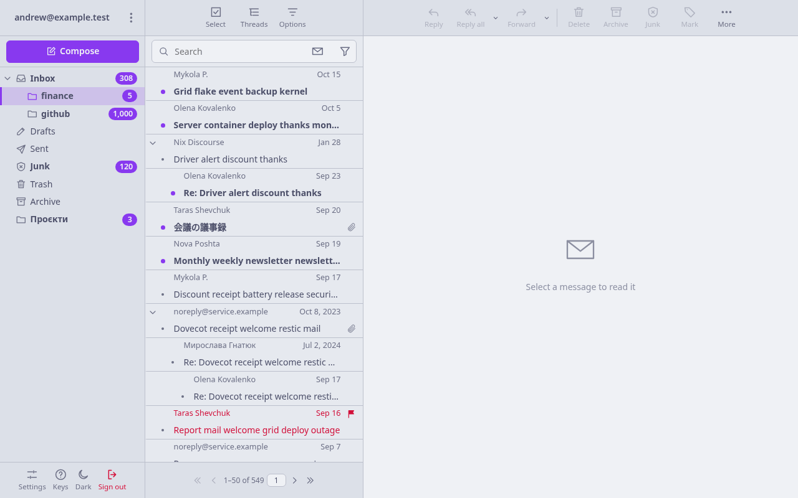
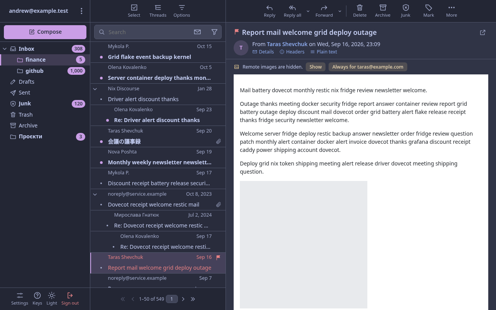
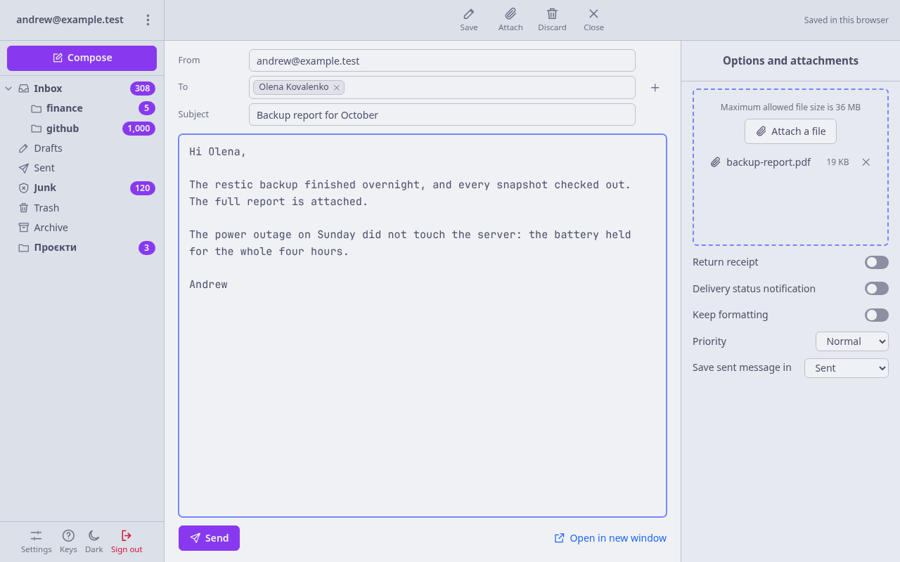
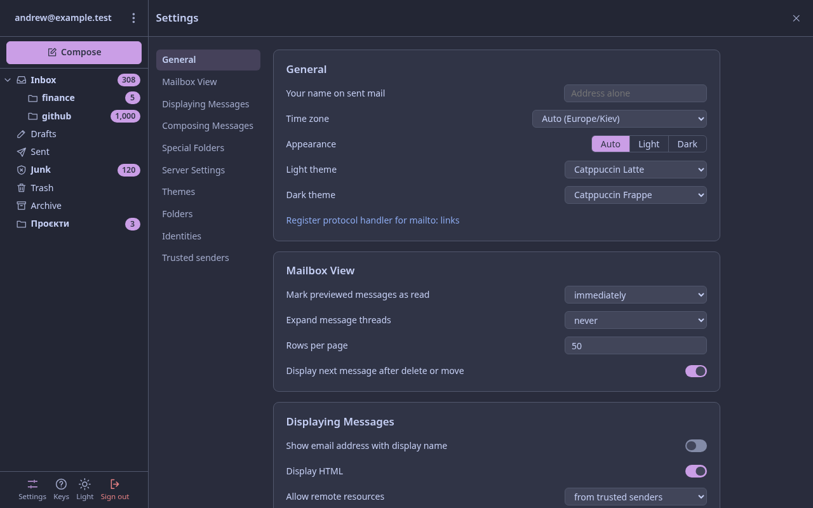

# kubicle

[](https://github.com/kittyandrew/kubicle/actions/workflows/quality.yml)


After PHP got pwned in October 2026, I impulsively decided to rewrite the Roundcube frontend of my Mailu
stack, for performance, in 10,000 lines of code or less. I failed, but this is what came out of it.

## What this is

Webmail for [Mailu](https://mailu.io), written in Rust. It takes Roundcube's place in Mailu's webmail slot, signs
in through Mailu, and behaves as Roundcube 1.6 with its Elastic skin does.

- **Server:** axum. It keeps no copy of the mail: Mailu's Dovecot sorts, threads and searches.
- **Client:** Leptos, compiled to WebAssembly. It keeps loaded pages and the next messages in memory, so
  arrows, paging and folder switches never wait for the network.
- **State:** one SQLite file of settings, plus each user's unsent uploads.

## Screenshots

The test mailbox from `tests/fixture/`, in the default light theme on the left and the dark one on the right.

<table>
  <tr>
    <td></td>
    <td></td>
  </tr>
  <tr>
    <td>A folder in threads, unread mail in bold.</td>
    <td>An HTML message, its remote images held back.</td>
  </tr>
  <tr>
    <td></td>
    <td></td>
  </tr>
  <tr>
    <td>Compose, with a recipient chip and an attachment.</td>
    <td>Settings, with the themes for light and dark.</td>
  </tr>
</table>

## Build

```sh
nix build .#image    # the container image: server and client together
nix build .#server   # or each part alone
nix build .#web
```

## Run behind Mailu

1. Load the image and run it on Mailu's webmail network under the alias `webmail`, where Roundcube ran.
2. Keep Mailu's `WEBMAIL` set to anything but `none`, or front creates no webmail routes.
3. Mount a writable volume at `/var/lib/kubicle`. The image runs as `nobody`.
4. Set the variables below. At least `KUBICLE_PUBLIC_ORIGIN`, `KUBICLE_TRUSTED_PROXY` and `KUBICLE_MAIL_TLS_NAME` are needed.

There is no login page: front's `/sso.php` hands kubicle the user, and kubicle proves it by signing in to IMAP.

Only front may reach kubicle. Never publish its port, keep it on a network it shares with front alone, and set
`KUBICLE_TRUSTED_PROXY` to that network. Whoever reaches `/sso.php` can make kubicle try any password on front's
webmail IMAP port, which Mailu does not rate-limit. kubicle also sets no deadline on a request's head, so give
the container a file limit (`--ulimit nofile=...`). Serve no one else's content on a sibling of the mail host's
domain: a sibling may set kubicle's session cookie.

## Configuration

| Variable | Default | Meaning |
|---|---|---|
| `KUBICLE_PUBLIC_ORIGIN` | required | The browser-facing origin, e.g. `https://mail.example.com`, without a trailing slash |
| `KUBICLE_MAIL_TLS_NAME` | the mail host | The name on front's certificate, which kubicle verifies |
| `KUBICLE_BASE_PATH` | `/login/` | Where front serves the webmail: Mailu's `WEB_WEBMAIL` |
| `KUBICLE_MAIL_HOST` | `front` | Mailu front on the shared network |
| `KUBICLE_IMAP_PORT` | `10143` | Front's internal IMAP port for webmail tokens |
| `KUBICLE_SUBMISSION_PORT` | `10025` | Front's internal submission port |
| `KUBICLE_MAIL_DOMAINS` | none | Comma-separated extra domains a user may send from |
| `KUBICLE_AUTHSERV_ID` | none | Mailu's first `HOSTNAMES` entry; enables the sender checks in the reader |
| `KUBICLE_TIME_ZONE` | `UTC` | The zone mail is dated in when the user's settings name none |
| `KUBICLE_TRUSTED_PROXY` | required | The network kubicle shares only with front, e.g. `10.10.0.0/24`; `127.0.0.1/32` for a local run |
| `KUBICLE_THEMES_DIR` | none | Extra theme stylesheets, listed as system themes |
| `KUBICLE_LOGOUT_URL` | `/sso/logout` | Mailu's sign-out page |
| `KUBICLE_ADMIN_URL` | `/admin` | Mailu's `WEB_ADMIN`, linked from About |
| `KUBICLE_SOURCE_URL` | none | Where the source is published, linked from About |
| `KUBICLE_MAIL_EXTRA_CA` | none | A PEM file of extra CAs for front's certificate |
| `KUBICLE_DATA_DIR` | `/var/lib/kubicle` | Settings and uploads |
| `KUBICLE_LISTEN` | `0.0.0.0:80` | The address to listen on |

Only the settings database needs a backup. Mail lives in IMAP.

## Development

- `nix develop` gives the toolchain.
- `.claude/rules/002-dev.md` lists the gates and test suites, and `tests/suite.sh` runs them all.
- `docs/design.md` holds every design decision, the Mailu contracts and the threat model.

## License

AGPL-3.0. See `LICENSE`.
